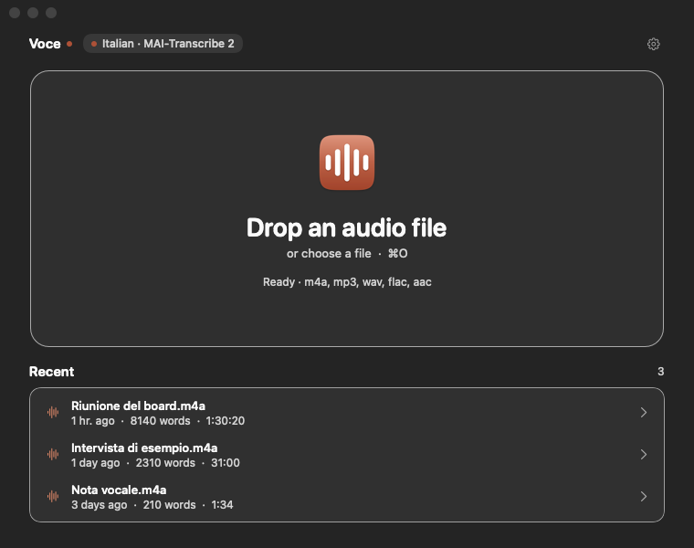
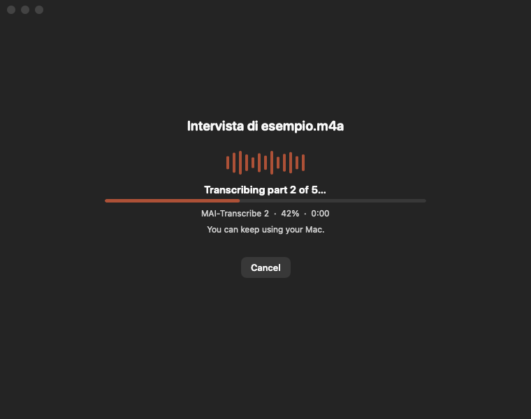
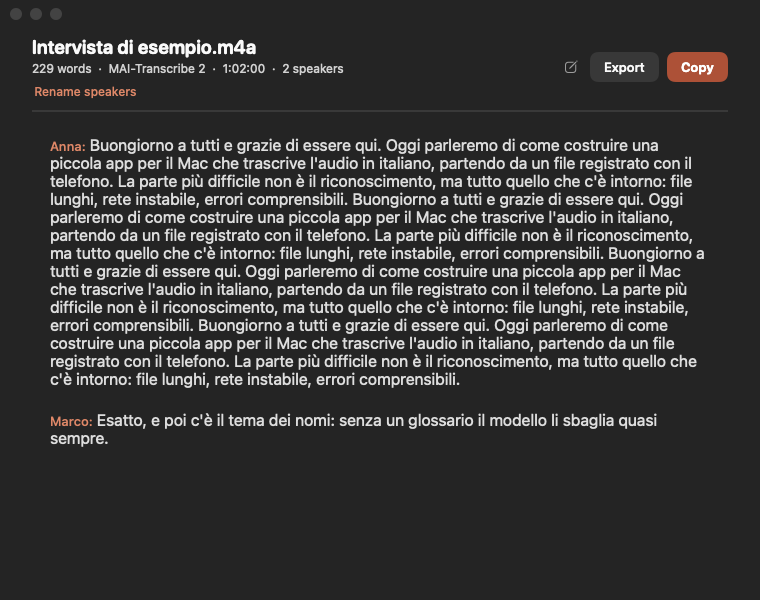
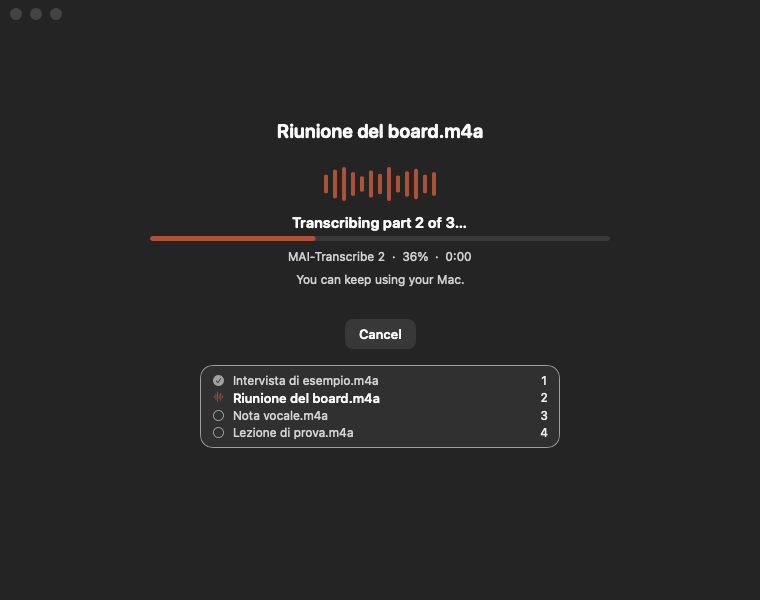
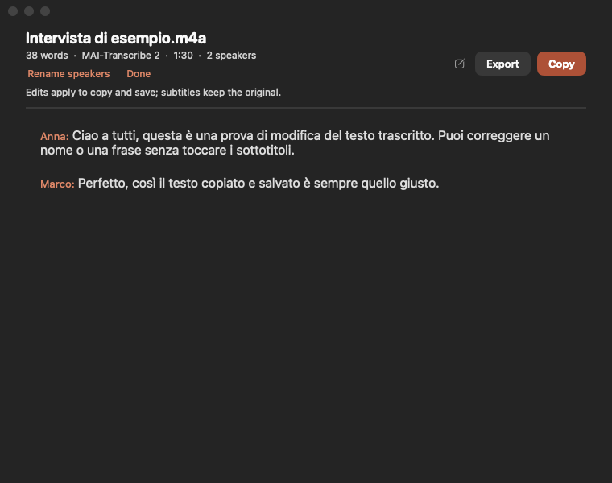
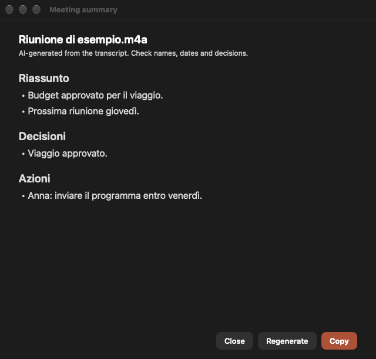
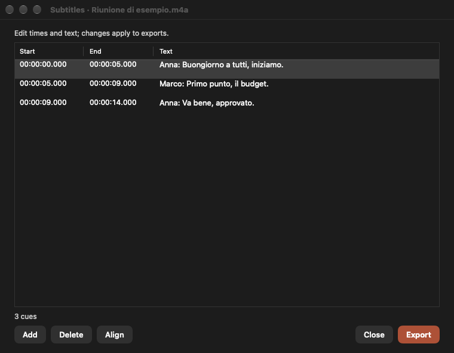
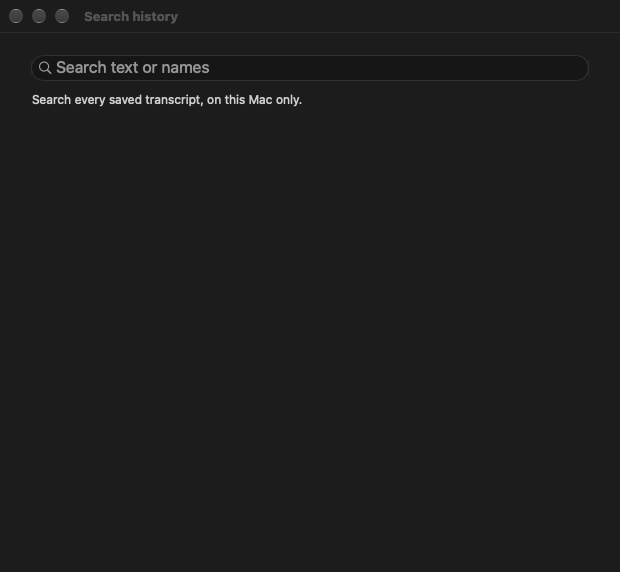
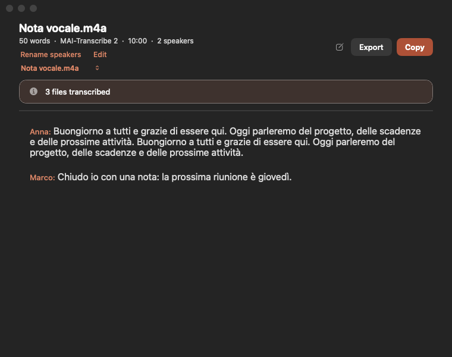

# Voce

**Audio to clean, speaker-aware text on macOS.** Drop a file, get a transcript with punctuation, speaker turns, subtitle export and a private local history.

Voce is a small native AppKit app built with Swift 6. It uses your own [OpenRouter](https://openrouter.ai) key and a transcription model of your choice. No account, no telemetry, no bundled secret.

[](https://github.com/MarioCodarin/Voce/actions/workflows/ci.yml)
[](LICENSE)

| Idle | Working | Result |
| --- | --- | --- |
|  |  |  |

| Batch queue | Editable transcript |
| --- | --- |
|  |  |

| Optional summary | Subtitle editor |
| --- | --- |
|  |  |

Search every saved transcript locally:



After a batch, every completed file stays one click away:



## Why Voce

- **Bring your own key.** Nothing is baked into the build. The key lives in the macOS Keychain and is never written to the repository or the logs.
- **Built for long meetings.** Files are sliced, compressed and stitched back together; repeated words at the seams are removed. A 90-minute meeting works out to roughly $0.16 with the default model.
- **Speaker turns.** The default model recognises who is speaking; rename `Parlante 1` to a real name and every copy, save and subtitle follows.
- **Quiet and efficient.** Uploads stream from disk in 192 KiB blocks, one audio slice exists at a time, and the UI animates on the GPU. Logs are rotating and content-free.
- **Private by default.** History is opt-in, stored only on this Mac with `0600` permissions, and clearable in one click. Audio is sent to OpenRouter for transcription; nothing else leaves the machine.

## Features

- Drag one or many files anywhere on the window, or press `⌘O`. They are transcribed one after another; a compact list shows the batch and the result keeps every file one click away.
- Supported: `m4a`, `mp3`, `wav`, `flac`, `aac`, `mp4`, `mov`, `ogg`, `webm`. Video files are read as audio tracks.
- Long recordings are split per model, with overlap, then stitched without duplicated words at the cuts.
- Speaker turns, optional punctuation/casing pass that never rewrites words.
- Audio language: **Automatic**, **Italiano**, **English**, **Español**, **Français**, **Deutsch**, **Português** (per job, from Settings).
- Interface language: Italian, English, Spanish, French, German, Portuguese, or follow the system.
- Result screen: copy (`⇧⌘C`), save/export `.txt`, `.srt`, `.vtt`, rename speakers, edit the text, find (`⌘F`).
- `⌘S` remembers the last export format; the menu title follows it.
- A global shortcut (`⌥⌘V` by default, configurable or off) opens the file picker from any app.
- Recent transcripts (opt-in), reopen with one click from the idle screen or the menu bar.
- Menu bar waveform with recent transcripts and “Transcribe a file…”.
- Six interface languages: Italian, English, Spanish, French, German and Portuguese.
- First-run onboarding with key validation and a link to create a key.
- Optional AI summary and action items, in a separate window and never mixed into the verbatim transcript.
- Subtitle editor: edit cue text and start/end times, add/delete cues, realign ends, export SRT/VTT/TXT.
- Search across local history by text or speaker name.
- Glossary learning: when you rename speakers, add those names to the glossary in one click.
- Drop an audio file directly on the menu-bar waveform.
- `--doctor` and a readable log for support.
- Empty and offline states explain what happened and keep the file safe with a retry in place.
- Cross-slice speaker re-identification: local speaker numbers that restart at a chunk seam are merged when the overlap text is strong enough.

## Requirements

- macOS 14 or later
- Swift 6 to build (Command Line Tools are enough)
- An OpenRouter account and key: [openrouter.ai/keys](https://openrouter.ai/keys)
- Optional: `ffmpeg` (`brew install ffmpeg`) for smaller uploads and faster compression. Without it Voce uses the system `afconvert`.

## Install

Build and install to `/Applications`:

```bash
git clone https://github.com/MarioCodarin/Voce.git
cd Voce
./scripts/install.sh
```

The app is ad-hoc signed (no Apple Developer account). On first launch, create a key on OpenRouter, paste it into the welcome screen, choose model and language, and start.

## First run

1. Voce opens a welcome sheet: **Create a key on OpenRouter**, paste it, press **Check**.
2. Choose a model. The default, **MAI-Transcribe 2**, is the most accurate on Italian names and the only one with speaker turns.
3. Choose the audio language (Italian by default; Automatic lets the provider detect it).
4. Decide whether to keep a local transcript history. It is off by default and never uploaded.
5. Drop an audio file, or press `⌘O`.

You can change everything later in **Voce › Impostazioni** (`⌘,`).

## Models

Prices are approximate, measured on a 90-minute meeting in late 2026. Check OpenRouter for current pricing.

| Model | ~90 min | Speakers | Notes |
| --- | ---: | :---: | --- |
| MAI-Transcribe 2 (default) | $0.16 | yes | Best Italian names, fast, 10-minute slices |
| Scribe v2 | $0.36 | no | Tidier sentences, slower, 4-minute slices |
| Voxtral Small 3 | $0.39 | no | Alternative, 5-minute slices |
| Whisper Large v3 | $0.04 | no | Previous model, 5-minute slices |

The glossary is sent per model: MAI uses Azure's `phraseList`, Whisper uses the legacy prompt fields.

## Command line

```bash
# transcribe next to the input
Voce --transcribe ~/Downloads/riunione.m4a

# subtitles in a specific place
Voce --transcribe talk.m4a --format srt --out ~/Desktop/talk.srt

# language, model, no cleanup
Voce --transcribe talk.m4a --language en --model "Scribe v2" --no-cleanup

# diagnostics (no secrets)
Voce --doctor
```

Run it without an app bundle (development):

```bash
swift build -c release
.build/release/Voce --transcribe file.m4a --out file.txt
```

Options: `--out`, `--format txt|srt|vtt`, `--language auto|it|en|es|fr|de|pt`, `--model`, `--no-cleanup`, `--quiet`, `--verbose`, `--doctor`, `--version`, `--help`.

## Your key

The key is resolved in this order:

1. `VOCE_OPENROUTER_KEY` environment variable
2. Keychain item saved from Settings (recommended)
3. First line of `~/.config/voce/openrouter.key` (created with `0600`)

```bash
mkdir -p ~/.config/voce
printf '%s\n' "sk-or-v1-..." > ~/.config/voce/openrouter.key
chmod 600 ~/.config/voce/openrouter.key
```

Never commit a key. The repository contains no key, and `.gitignore` excludes key files, environment files and audio.

## Privacy and data

| Data | Where | Notes |
| --- | --- | --- |
| API key | macOS Keychain (service `it.voce.openrouter`) | Never in logs or the repo |
| Audio | Sent to OpenRouter | Only as part of the transcription request |
| Transcripts history | `~/Library/Application Support/Voce/Transcripts` | Opt-in, `0600`, max 100 records |
| Glossary | `~/.config/voce/glossary.txt` or the bundled sample | `0600`, local only |
| Logs | `~/Library/Logs/Voce/voce.log` | Rotating, no key/transcript/paths |

There is no telemetry, no analytics and no crash reporting service. See [SECURITY.md](SECURITY.md).

## Glossary

Voce's accuracy on names depends on a glossary. The app ships a neutral sample; your own list is saved to `~/.config/voce/glossary.txt`.

- One word or name per line.
- Lines starting with `#` are headings and are not sent.
- Settings can import/export the list and restore the sample.
- The same list is capped at 2,000 terms and sent with every chunk.

## Development

```bash
swift build                    # app + library
./scripts/test.sh              # all tests (handles the Command Line Tools setup)
swift test                     # with Xcode selected
```

`VoceKit` contains everything that decides *what* happens (audio, network, stitching, archive). `Voce` contains everything that decides *how* it looks. `VoceKit` never imports AppKit, so it is unit-testable.

See [docs/ARCHITECTURE.md](docs/ARCHITECTURE.md) for the module map, data flow and the memory/CPU budget, and [docs/UX.md](docs/UX.md) for the product direction. Contributions are welcome: [CONTRIBUTING.md](CONTRIBUTING.md).

## Struttura

```
Sources/
  VoceKit/            logica, senza AppKit
    Audio/            formati, slicing, conversione, file temporanei
    CLI/              comandi, argomenti, doctor
    Config/           impostazioni, modelli, lingua, chiave, glossario
    Network/          client OpenRouter, richieste, validazione chiave
    Storage/          cronologia locale, formati di esportazione
    Support/          log, versione, link, manutenzione
    Transcription/    orchestrazione, segmenti, ricucitura, pulizia, sottotitoli
  Voce/               app AppKit
    Controllers/      stato della finestra e job
    Localization/     testi IT/EN
    Theme/            design system e controlli
    Views/            schermate, onboarding, impostazioni, menu bar
Tests/VoceKitTests/
docs/
scripts/
```

## Italiano

Voce trasforma l'audio di una riunione in testo ordinato, con chi parla, punteggiatura e sottotitoli. Funziona interamente sul Mac tranne l'audio, che viene inviato a OpenRouter con la tua chiave.

- Trascina un file nella finestra o premi `⌘O`; supporta m4a, mp3, wav, flac, aac, mp4, ogg, webm.
- La chiave OpenRouter si inserisce al primo avvio e resta nel Portachiavi. Non è mai nel repository.
- Il modello predefinito è MAI-Transcribe 2 (~$0,16 per 90 minuti) e riconosce chi parla.
- Puoi copiare, salvare in `.txt`, esportare `.srt`/`.vtt` e rinominare i parlanti.
- La cronologia locale è facoltativa, resta su questo Mac e si cancella dalle Impostazioni.
- Interfaccia in italiano o inglese, segue il sistema.

Installazione:

```bash
./scripts/install.sh
```

Diagnostica:

```bash
Voce --doctor
```

## License

[MIT](LICENSE)
